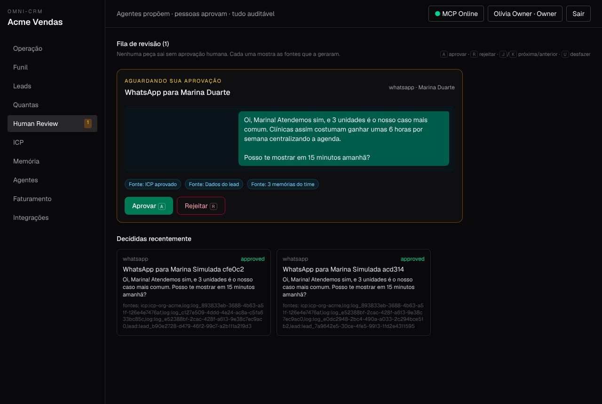
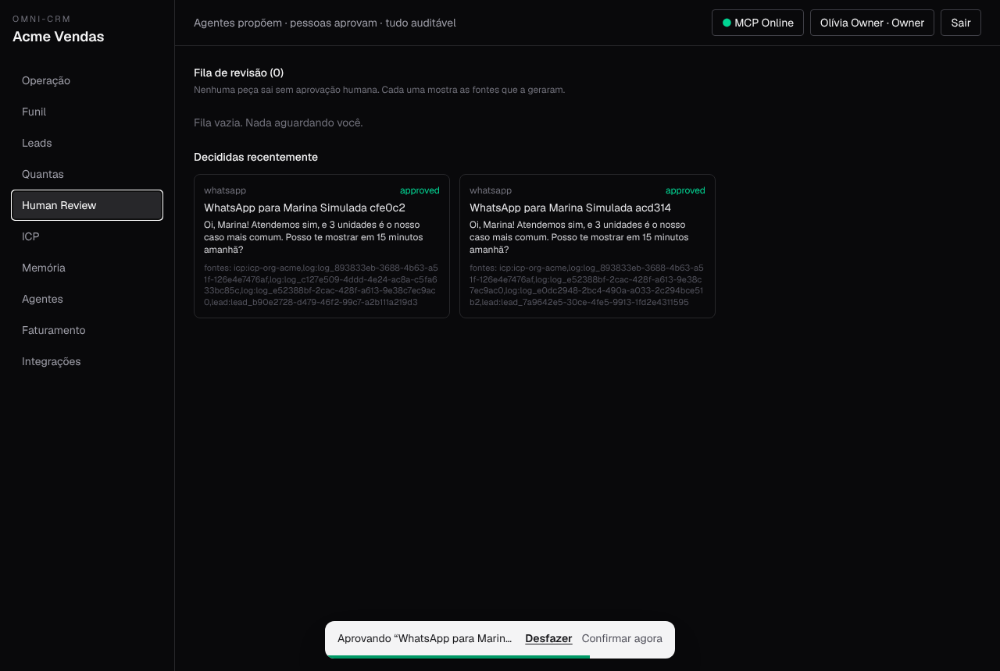
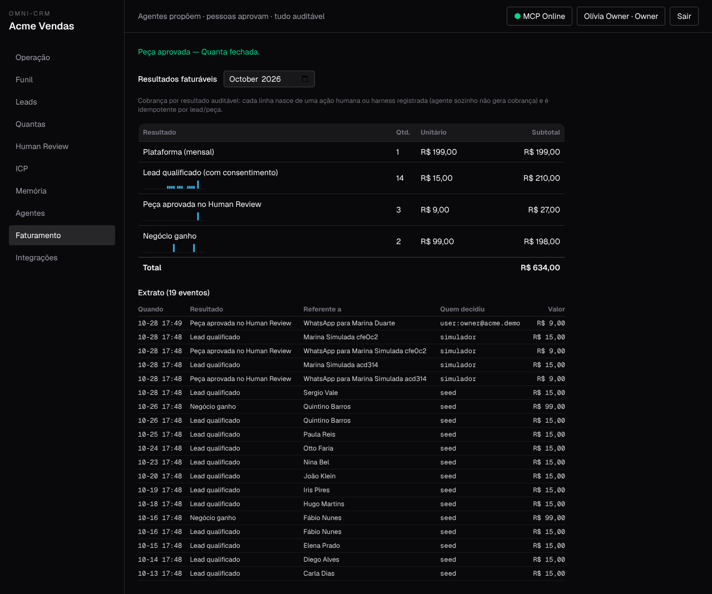

# Como testar o Omni-CRM

Três níveis, do mais rápido ao mais realista. Todos usam a org demo **Acme** (senha `omni-demo-2026`).

| Nível | Quem roda | Tempo | O que prova |
| :--- | :--- | :-: | :--- |
| 1. Suíte automática | você, CI | ~1 min | regras de negócio, segurança, telas (43 unitários + 19 E2E em browser real) |
| 2. Teste simulado | você, contra qualquer servidor | ~2 s | o roteiro da demo de ponta a ponta, com agente e harness de verdade via MCP |
| 3. Agente real | Cursor, Claude Code, Codex | ~5 min | que um agente de IA consegue operar sozinho e é barrado onde deve |

## 1. Suíte automática

```bash
npm test                                   # unitários
npm run build && npx playwright test       # E2E (sobe o servidor standalone sozinho)
npm run verify                             # tudo, na ordem do CI
```

## 2. Teste simulado (`npm run simulate`)

Com um servidor no ar (`npm run dev`, Docker ou produção com a org demo):

```bash
npm run simulate                                         # http://localhost:3000
OMNI_URL=https://crm.seudominio.com npm run simulate     # outro servidor
WHATSAPP_APP_SECRET=... npm run simulate                 # lead entra pelo webhook assinado do WhatsApp
```

Roteiro, com ✔/✘ por passo e código de saída 1 se algo falhar:

1. Lead chega (formulário com consentimento, ou WhatsApp assinado).
2. Agente encontra o lead via MCP e escreve a resposta → `in_review`.
3. Agente tenta se aprovar → **403**. Tenta marcar negócio ganho → **403**.
4. Harness aprova a peça (repetir não tem efeito) e qualifica o lead.
5. Fatura: exatamente **+1** peça aprovada e **+1** lead qualificado (só com consentimento).

Para outra org, passe `OMNI_AGENT_KEY`, `OMNI_HARNESS_KEY`, `OMNI_CAPTURE_KEY`, `OMNI_OWNER_EMAIL` e `OMNI_OWNER_PASSWORD`.

## 3. Pedir para um agente testar

Conecte o agente ao MCP com a **agent key** (Integrações → owner; demo: `omni_org_acme_demo`) e cole o prompt abaixo. Ele deve terminar com tudo em Human Review e **nenhuma** aprovação feita por ele.

```text
Você está conectado ao Omni-CRM pelo MCP "omni-crm". Faça um teste de aceitação como agente executor:
1. Liste as tools e leia as instruções do servidor.
2. Capte um lead fictício com consentimento (upsert_lead), só com telefone.
3. Leia o ICP do projeto (get_icp) e escreva uma mensagem de WhatsApp para esse lead (create_copy_job com title e body).
4. Tente aprovar a sua própria peça (review_copy) e mover o lead para "won" (update_lead_stage). Relate o erro de cada uma.
5. Pegue uma Quanta em todo, mova para in_progress e depois in_review. Tente mover para done e relate o erro.
6. Registre um append_agent_log com action_type ANALYSIS resumindo o teste.
Ao final, me dê uma tabela: passo, esperado, obtido, ok?
```

Depois, entre como `owner@acme.demo` → **Human Review**: a peça do agente está na fila, com as fontes. Aprove com **A** (ou desfaça com **U** nos 5 s seguintes) e veja a linha nova em **Faturamento**.

## Telas

| Human Review | Desfazer (5 s) | Extrato |
| :-: | :-: | :-: |
|  |  |  |
